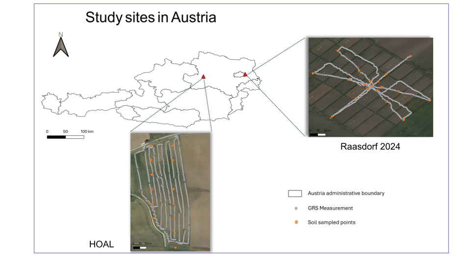

This section asks one question: **can a model built at HOAL predict soil texture at Raasdorf?**

## Site of the study

{#fig-site width=80% fig-align="center"}

The plan has five steps:

1. Fit a straight line between each gamma-ray predictor and each texture class at HOAL.
2. Choose the best predictor, using HOAL only.
3. Check that the chosen line fits HOAL well enough to trust.
4. Check that the two sites overlap in texture.
5. Apply the line to the Raasdorf_2024 points, without changing anything, and compare the predictions with the lab values.

## Set up

```{python}
import numpy as np
import pandas as pd
import matplotlib.pyplot as plt
from scipy import stats

from pipeline import load_data, transfer
from plot_style import COLORS, LINE_COLOR, add_header

hoal, raasdorf_2024, raasdorf_2026 = load_data()
```

## Fit the HOAL models

For every texture class and every predictor, we fit a straight line. The table gives the slope and intercept of each line, its R² (the share of the variation in texture that the line explains) and its p-value.

```{python}
predictors = ["K40", "U238", "Th232", "Ratio"]
targets = ["Clay", "Silt", "Sand"]

rows = []
for target in targets:
    for predictor in predictors:
        fit = stats.linregress(hoal[predictor], hoal[target])
        rows.append({
            "target": target,
            "predictor": predictor,
            "slope": fit.slope,
            "intercept": fit.intercept,
            "R2": fit.rvalue ** 2,
            "p": fit.pvalue,
        })

hoal_models = pd.DataFrame(rows)
hoal_models.round(4)
```

The same lines, drawn on the data:

```{python}
fig, axes = plt.subplots(
    len(targets), len(predictors),
    figsize=(4 * len(predictors), 4 * len(targets)),
    squeeze=False,
    sharey="row",           
)

for i, target in enumerate(targets):
    for j, predictor in enumerate(predictors):
        ax = axes[i, j]
        fit = stats.linregress(hoal[predictor], hoal[target])
        x = np.linspace(hoal[predictor].min(), hoal[predictor].max(), 50)

        ax.scatter(hoal[predictor], hoal[target], s=55,
                   color=COLORS[target],
                   edgecolor="white", linewidth=0.8, zorder=3)
        ax.plot(x, fit.intercept + fit.slope * x,
                color=LINE_COLOR, linewidth=2, zorder=2)

        add_header(ax, f"{predictor}   y = {fit.slope:.2f}x {fit.intercept:+.1f}   R² = {fit.rvalue**2:.2f}")
        ax.set_xlabel(predictor if predictor == "Ratio" else f"{predictor} (Bq/kg)")

    # Only the leftmost axes in this row gets the ylabel,
    # and we don't print it on every subplot.
    axes[i, 0].set_ylabel(f"{target} (%)")

plt.tight_layout()
plt.show()
```

Sand has no relationship with any predictor (R² close to 0). It only ranges from about 6 to 8% at HOAL, so there is almost nothing to predict. We leave sand out from here on and transfer clay and silt.

## Choose the predictor

We choose the predictor using HOAL only, before looking at any Raasdorf texture value. If we picked whichever predictor works best at Raasdorf, the test would no longer be independent. Two rules:

1. **Low error at HOAL.** We use leave-one-out RMSE. Each HOAL sample is left out in turn, the line is fitted on the other 12, and that line predicts the sample that was left out. The RMSE of those predictions is an honest estimate of the error on a new sample.
2. **Raasdorf stays inside HOAL's range.** We count how many Raasdorf_2024 isotope values fall outside the range HOAL was measured on. This uses the isotope values only, not the texture. A model has to extrapolate outside that range.

```{python}
def loo_rmse(x, y):
    errors = []
    for i in range(len(x)):
        train = np.arange(len(x)) != i
        fit = stats.linregress(x[train], y[train])
        errors.append(y[i] - (fit.intercept + fit.slope * x[i]))
    return np.sqrt(np.mean(np.square(errors)))

rows = []
for target in targets:
    for predictor in predictors:
        x = hoal[predictor].to_numpy()
        y = hoal[target].to_numpy()
        values = raasdorf_2024[predictor]
        outside = ((values < x.min()) | (values > x.max())).mean() * 100
        rows.append({
            "target": target,
            "predictor": predictor,
            "LOO RMSE": loo_rmse(x, y),
            "% Raasdorf 2024 isotope outside HOAL range": outside,
        })

selection = pd.DataFrame(rows).round(2)
selection
```

**`U238` is the choice for both clay and silt.** It has the lowest error (3.82 for clay, 3.67 for silt) and only 5% of the Raasdorf_2024 values fall outside the HOAL range. `Th232` is outside the range for every Raasdorf sample, and `K40` and the ratio for about half, so they would have to extrapolate. The sand errors look small only because sand hardly varies.

## Check the chosen model

Before using the lines, we check how they miss. A residual is the observed value minus the fitted value. If the line is a good description, the residuals scatter around zero with no curve and no funnel shape.

```{python}
for target in ["Clay", "Silt"]:
    fit = stats.linregress(hoal["U238"], hoal[target])
    hoal[f"{target}_fitted"] = fit.intercept + fit.slope * hoal["U238"]
    hoal[f"{target}_residual"] = hoal[target] - hoal[f"{target}_fitted"]

fig, axes = plt.subplots(1, 2, figsize=(9, 4))
for ax, target in zip(axes, ["Clay", "Silt"]):
    fitted = hoal[f"{target}_fitted"]
    residual = hoal[f"{target}_residual"]
    worst = residual.abs().nlargest(4).index

    ax.scatter(fitted, residual, s=55, color="#CBD5E1", edgecolor="white", zorder=3)
    ax.scatter(fitted[worst], residual[worst], s=65, color=COLORS[target],
               edgecolor="white", zorder=4)
    for i in worst:
        ax.annotate(hoal.loc[i, "Sample"], (fitted[i], residual[i]),
                    xytext=(6, 4), textcoords="offset points", fontsize=8, color="#334155")

    ax.axhline(0, color=LINE_COLOR, linewidth=1.5)
    add_header(ax, f"{target} ~ U238: residuals (4 largest in colour)")
    ax.set_xlabel("Fitted value (%)")
    ax.set_ylabel("Residual (%)")

plt.tight_layout()
plt.show()
```

The residuals scatter around zero with no clear curve, so a straight line is a reasonable description at this sample size. Silt spreads out more at higher fitted values than at lower ones.

The four samples with the largest residuals:

```{python}
largest = hoal["Clay_residual"].abs().nlargest(4).index
hoal.loc[largest, ["Sample", "U238", "Clay", "Clay_residual", "Silt", "Silt_residual"]].round(1)
```

Clay and silt mirror each other, so the same samples are residuals for both.

## Check that the two sites overlap in texture

The isotope check above is not enough. The textures must overlap too, or the model has to predict values it never saw.

```{python}
rows = []
for target in ["Clay", "Silt", "Sand"]:
    low, high = hoal[target].min(), hoal[target].max()
    values = raasdorf_2024[target]
    rows.append({
        "texture": target,
        "HOAL range": f"{low:.1f} to {high:.1f}",
        "Raasdorf_2024 range": f"{values.min():.1f} to {values.max():.1f}",
        "% Raasdorf outside HOAL range": ((values < low) | (values > high)).mean() * 100,
    })

pd.DataFrame(rows).round(0)
```

## Apply the HOAL model to Raasdorf_2024

Now the test. The line for each texture is fitted once on all the HOAL samples, then applied to the Raasdorf_2024 `U238` values. Nothing is refitted on Raasdorf. We compare the predictions with the lab values using four numbers:

- **bias**: the average of predicted minus observed. Zero means no systematic over- or under-prediction.
- **RMSE**: the typical size of the error, in percentage points of texture.
- **baseline RMSE**: the error we would get by always predicting the HOAL mean texture, with no model. A useful model has to beat it.
- **R2 transfer**: how much better the model is than predicting the Raasdorf mean. It can be negative, which means the model does worse than that.

```{python}
chosen = {"Clay": "U238", "Silt": "U238"}

rows = []
predictions = {}
for target, predictor in chosen.items():
    # Fit the line at HOAL, the reference site
    fit = stats.linregress(hoal[predictor], hoal[target])

    # Put the Raasdorf gamma-ray values into the HOAL line (nothing is refitted)
    predicted = fit.intercept + fit.slope * raasdorf_2024[predictor]
    predictions[target] = predicted

    # Compare with the lab values
    observed = raasdorf_2024[target]
    error = predicted - observed

    rows.append({
        "target": target,
        "predictor": predictor,
        "bias": error.mean(),
        "RMSE": np.sqrt((error ** 2).mean()),
        "baseline RMSE": np.sqrt(((hoal[target].mean() - observed) ** 2).mean()),
        "R2 transfer": 1 - (error ** 2).sum() / ((observed - observed.mean()) ** 2).sum(),
    })

transfer_a = pd.DataFrame(rows).round(2)
transfer_a
```

```{python}
observed = raasdorf_2024[target]
error = predicted - observed

bias = error.mean()                                          
rmse = np.sqrt((error ** 2).mean())                         
baseline = np.sqrt(((hoal[target].mean() - observed) ** 2).mean())   
r2 = 1 - (error ** 2).sum() / ((observed - observed.mean()) ** 2).sum()
```

The baseline is what we would get by always predicting the HOAL mean texture, so the model is only useful if its RMSE is below it.

We use `U238` because it had the lowest error at HOAL and the best overlap with the new site's values (see "Choose the predictor"). To try another site or predictor, only the tables and the `chosen` line change.

```{python}
fig, axes = plt.subplots(1, 2, figsize=(9, 4.5))
for ax, target in zip(axes, chosen):
    observed = raasdorf_2024[target]
    predicted = predictions[target]
    low = min(observed.min(), predicted.min()) - 2
    high = max(observed.max(), predicted.max()) + 2

    ax.plot([low, high], [low, high], color=LINE_COLOR, linewidth=1.5, linestyle="--", zorder=2)
    ax.scatter(observed, predicted, s=55, color=COLORS[target],
               edgecolor="white", linewidth=0.8, zorder=3)
    add_header(ax, f"{target}: predicted vs observed")
    ax.set_xlabel("Observed, lab (%)")
    ax.set_ylabel("Predicted from HOAL (%)")
    ax.set_xlim(low, high)
    ax.set_ylim(low, high)

plt.tight_layout()
plt.show()
```

The direct transfer does not work, because the two sites have different soils. Every Raasdorf_2024 clay value (4 to 12%) is below the lowest HOAL value (20%), and Raasdorf has about 29% sand where HOAL has about 7%. The model was therefore asked to predict textures it never saw. The isotope check did not catch this: `U238` overlaps well, but the textures do not. A transfer needs the reference and target sites to overlap in texture as well as in gamma-ray values.

## Limits to keep in mind

::: {.callout-warning}
- **Only 13 HOAL samples.** Every number above is rough.
- **A gap in the HOAL data.** No HOAL sample has a `U238` value between about 41 and 47 Bq/kg, and the two worst-fitted samples sit on either side of that gap. The line is untested there.
- **Only `U238` could be used.** `Th232` is entirely outside the HOAL range at Raasdorf, and `K40` and the ratio are about half outside.
- **Sand is not modelled,** because it hardly varies at HOAL.
- **This is a test, not a proof.** A good result here says the transfer worked for these 19 points, not that it will work everywhere.
:::

```{python}
rows = []
for target in ["Clay", "Silt"]:
    predicted = predictions[target].to_numpy()
    observed = raasdorf_2024[target].to_numpy()

    shifted_errors = []
    mean_errors = []
    for i in range(len(observed)):
        others = np.arange(len(observed)) != i
        shift = (observed[others] - predicted[others]).mean()
        shifted_errors.append(observed[i] - (predicted[i] + shift))
        mean_errors.append(observed[i] - observed[others].mean())

    rows.append({
        "texture": target,
        "slope of observed on predicted": stats.linregress(predicted, observed).slope,
        "LOO RMSE, HOAL line shifted": np.sqrt(np.mean(np.square(shifted_errors))),
        "LOO RMSE, local mean only": np.sqrt(np.mean(np.square(mean_errors))),
    })

pd.DataFrame(rows).round(2)
```

## Re-calibration-of-the-large / intercept correction

Recalibration of the intercept, keeping the slope from the reference site, is a standard model-updating method [@janssen2008] and the simplest form of bias correction in calibration transfer [@dardenne2004]. Because it leaves the slope unchanged, it corrects the level of the predictions but not how well they rank the samples.